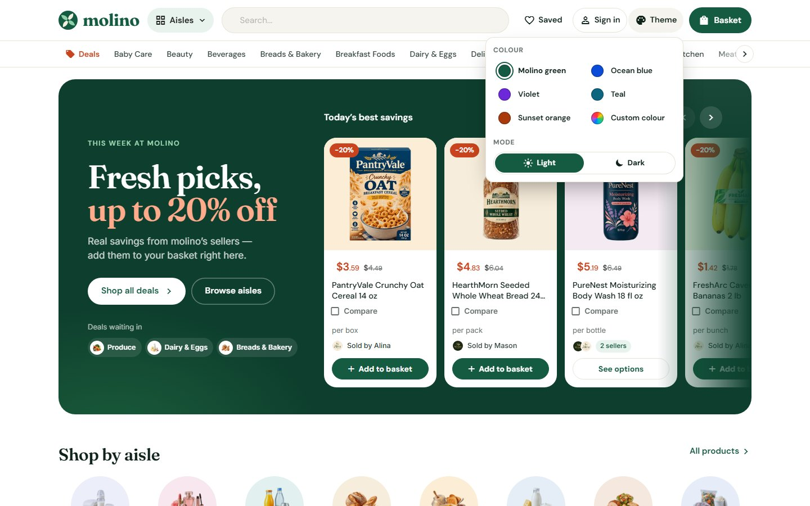
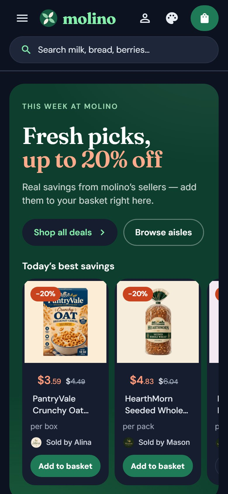
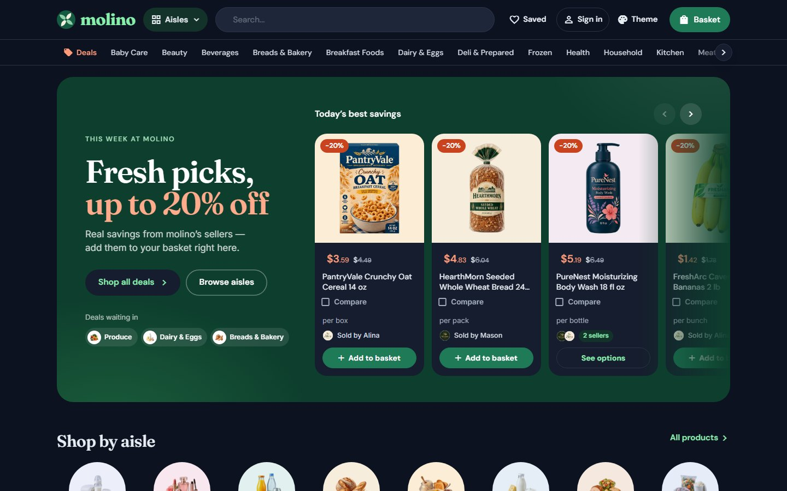

<p align="center">
  
</p>

<h1 align="center">Molino Market Hall</h1>

<p align="center">
  <b>A multi-vendor grocery storefront for Selldone, in the spirit of Amazon Fresh.</b><br>
  A custom Selldone Layout built on the official <a href="https://github.com/selldone/storefront">selldone/storefront</a>.
</p>

<p align="center">
  <a href="https://molino.selldone.shop"></a>
  <a href="https://github.com/selldone-custom-layouts/official-molino/wiki"></a>
  <a href="https://github.com/selldone-custom-layouts/official-molino/wiki/Install-with-AI"></a>
  
  
</p>

<p align="center">
  <a href="https://molino.selldone.shop"><b>Open the live shop</b></a> ·
  <a href="https://github.com/selldone-custom-layouts/official-molino/wiki/Install-with-AI">Set it up with AI</a> ·
  <a href="https://github.com/selldone-custom-layouts/official-molino/wiki/Manual-Setup">Manual setup</a> ·
  <a href="https://github.com/selldone-custom-layouts/official-molino/wiki/Shop-Requirements">What your shop needs</a> ·
  <a href="https://github.com/selldone-custom-layouts">All Selldone custom layouts</a>
</p>

---

## What it is

Molino Market Hall is the storefront of **[molino](https://molino.selldone.shop)**, a grocery marketplace on Selldone where several sellers sell milk, fruit, bread and household goods. Every page is redesigned, so it does not look like Selldone's default storefront, while Selldone's own basket, checkout, payments, vendor offers and orders keep working underneath.

Use it as the storefront of your own Selldone shop: groceries, a supermarket, a farm shop, a pharmacy, or any multi-vendor catalogue of everyday products.

## Highlights

- **Marketplace home:** a "deals counter" banner, two rows of aisles, product rows six wide, an aisle mosaic, seller cards and a market shelf. Everything comes from your shop's live data: every top-level category becomes an aisle with its own row of best sellers, the banner shows the products on offer, and a section with nothing to show folds away.
- **Amazon-style cards:** "Add to basket" on every card turns into "− 1 in basket +" in place. "See options" appears for products with sizes, and "Out of stock" when nothing is left. The seller is named on every card.
- **Shop pages:** a quiet aisle page with a compact head, filters built from product specs, one sort menu, and the normal grid on every device.
- **Product page:** three columns: gallery, details and a sticky buy box with every seller's offer. The struck price and percentage follow the chosen seller.
- **Ratings and reviews:**
  - **Cards:** a quiet "★★★★☆ 4.2 (19)" line under the name.
  - **Product page:** the score and the number of ratings under the title, which jump to the reviews.
  - **Reviews:** a summary column (score, stars, the shop's rating criteria, a sign-in prompt or a buyer's own rating) beside the comments, with the buyer badge, each writer's stars and the shop's reply.
  - Nothing shows until someone rates.
- **Seller storefronts:** each vendor gets a page with their mark, their aisles and their offers.
- **Basket and checkout:** a receipt-style basket drawer and basket page (lines by seller, delivery method, where, who). A map-first address sheet works on phones too: live suggestions, tap the pin, and two steps on small screens.
- **Orders and account:** an order page with the receipt, delivery card, the trip and chat bubbles. The buyer account comes in two designs, picked at build time.
- **Content pages:** journal, article, About, Terms and Privacy, with sample text until your shop writes its own.
- **Everywhere:** one theme colour (Vuetify's primary is set to it), skeletons while loading, no "Added to basket" pop-ups, and no phone bottom bar.

## Screenshots

| Home | Aisle | Product | Basket |
| --- | --- | --- | --- |
|  |  |  |  |
|  |  |  |  |

All screenshots are taken from the live shop, [molino.selldone.shop](https://molino.selldone.shop).

## Use it on your shop

| You want to… | Read |
| --- | --- |
| Let an AI agent (Claude Code, Codex…) set it up for your shop | [Install with AI](https://github.com/selldone-custom-layouts/official-molino/wiki/Install-with-AI) |
| Do it yourself, step by step | [Manual Setup](https://github.com/selldone-custom-layouts/official-molino/wiki/Manual-Setup) |
| Know what data your shop needs for the design to look right | [Shop Requirements](https://github.com/selldone-custom-layouts/official-molino/wiki/Shop-Requirements) |
| Build, upload and verify a release | [Build and Upload](https://github.com/selldone-custom-layouts/official-molino/wiki/Build-and-Upload) |
| Put the Layout live on your shop and domain | [Go Live](https://github.com/selldone-custom-layouts/official-molino/wiki/Go-Live) |
| Change colours, fonts, sections or pages | [Customize](https://github.com/selldone-custom-layouts/official-molino/wiki/Customize) |
| Fix a blank page, a rejected upload or an old version showing | [Troubleshooting](https://github.com/selldone-custom-layouts/official-molino/wiki/Troubleshooting) |

The wiki's source is also in this repository, in [`docs/wiki/`](docs/wiki/), so an AI agent that clones the repo has the same instructions.

<!-- THEME:START -->
### Theme and colours

Choose Molino's colours in one file, `components/kalio/molino-theme.settings.ts`:

- `palette`: green, blue, violet, teal, orange;
- or `brandColor`: any `#RRGGBB`, made readable automatically (`textOnBrand: "auto"` keeps a light brand such as yellow, with dark words);
- `mode`: light or dark;
- `themeSwitcher`: showcase, on or off.

You can also tell your AI agent "use the yellow theme" or "make it dark": `AGENTS.md` (section "Theme") tells it what to change. Then build and upload. See the wiki page [Theme and colours](https://github.com/selldone-custom-layouts/official-molino/wiki/Theme-and-colours).

The header's Theme button (palettes, Custom colour, Light / Dark) is a showcase feature. It shows only on Molino's own showcase shop (molino, Selldone shop 15645), so when you import Molino into your shop, your shoppers see Molino in its designed colours, with no Theme button. The Layout looks exactly as it does without the switcher, and any stored choice is ignored. To offer the switcher to your shoppers, set `themeSwitcher: "on"` in `components/kalio/molino-theme.settings.ts`, then build and upload. `themeSwitcher: "off"` hides it everywhere.
<!-- THEME:END -->

<p> </p>



## Quick start (developers)

```bash
git clone --recurse-submodules https://github.com/selldone-custom-layouts/official-molino.git
cd official-molino
npm install --force
npm run serve            # dev server on http://localhost:9123
```

Set your own shop in `.env` (`VITE_APP_SAMPLE_SHOP_NAME`, currency, country, language, theme colours); in production Selldone injects the shop that runs the Layout. Releases: `bash scripts/release.sh <new-version> desk`. See [Build and Upload](https://github.com/selldone-custom-layouts/official-molino/wiki/Build-and-Upload).

## Where things are

| Area | Files |
| --- | --- |
| Design notes, release log and every workaround | [`KALIO.md`](KALIO.md) |
| Molino's own components | [`components/kalio/`](components/kalio/) |
| Styles: tokens, shell, platform skin, sections, product, checkout, account, pages | [`style/`](style/) |
| Pages Molino rewrote: product, shop, basket, order, user | [`pages/`](pages/) |
| Release tooling: SVG flattening, upload, server check, release script | [`scripts/`](scripts/) |
| Fixes inside Selldone's submodules, kept as patches | [`patches/`](patches/) |
| AI agent kit from Selldone | [`.ai-agent/`](.ai-agent/) |
| Selldone storefront's original README | [`README.selldone.md`](README.selldone.md) |

## Credits and license

Built on the official [Selldone Storefront](https://github.com/selldone/storefront) (MIT License, © Selldone); see [`LICENSE.md`](LICENSE.md). Part of **[Selldone Custom Layouts](https://github.com/selldone-custom-layouts)**, the collection of official custom Layouts for Selldone shops.
